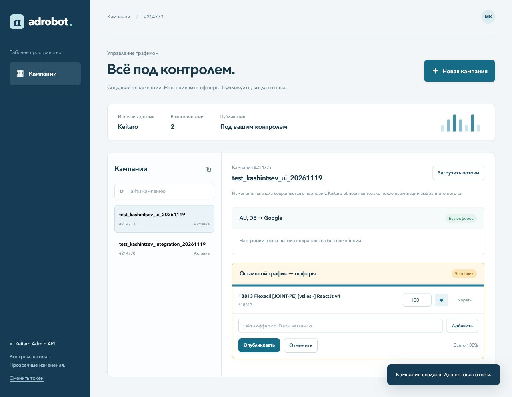

# Adrobot

Обёртка над Keitaro Admin API для создания кампаний и редактирования офферов в потоках. Финальное тестовое ETOLEGKO. FastAPI + SQLAlchemy + Alembic; интерфейс на HTML/CSS/JavaScript без сборки и CDN.

## Запуск

Нужен Python 3.13+. Команды из корня репозитория:

```sh
python3 -m venv .venv
source .venv/bin/activate
pip install -r requirements.txt
cp .env.example .env
```

В `.env` укажите HTTPS-адрес вашего Keitaro **без** `/admin`, существующий Admin API key и случайный `APP_TOKEN` (например, `python3 -c 'import secrets; print(secrets.token_urlsafe(32))'`). Укажите `CAMPAIGN_PREFIX`, если требуется другой тестовый префикс. Значения `.env` не коммитятся.

```sh
python -c 'import run; from alembic.config import Config; from alembic import command; command.upgrade(Config("alembic.ini"), "head")'
python run.py
```

Открыть http://127.0.0.1:8787 и ввести **APP_TOKEN**, не Keitaro API key. Сервер слушает только loopback. Один процесс/worker. Для внешнего размещения нужны HTTPS reverse proxy и собственная модель доступа; публичный хостинг с тестовым общим ключом намеренно не настроен.

## Интерфейс



## Что реализовано

- Создание кампании: название, одна или несколько стран (ISO alpha-2), поиск оффера по имени/ID с подсказками, домен, группа, источник из API.
- Первый поток: `forced`, фильтр `country/accept`, HTTP redirect на Google. Второй: `default`, выбранный оффер. Кампания создаётся отключённой, включается только после создания обоих потоков.
- Fetch streams сохраняет снимок в SQLAlchemy/SQLite. Потоки без офферов показываются как доступные только для чтения: фильтры/действия не переписываются.
- Добавление, удаление из потока, архив и восстановление. Глобальные офферы Keitaro не удаляются и не изменяются.
- Черновик хранится в БД и переживает перезагрузку/перезапуск. До Push Keitaro не меняется. Cancel восстанавливает опубликованный снимок, включая закрепления, и убирает новые непубликовавшиеся привязки.
- Удалённые снаружи офферы после Fetch сохраняются в локальном архиве и могут быть восстановлены.
- Закреплённые проценты не меняются при добавлении/удалении остальных офферов. Остаток делится поровну; целочисленный остаток распределяется стабильно по порядку (например, 34/33/33). Активные доли в сумме дают ровно 100. Невозможные закрепления и удаление последнего активного оффера отклоняются.
- Версия черновика защищает от устаревшей вкладки. Перед Push проверяется полный снимок удалённого потока. При конфликте сервер возвращает 409, не перезаписывая внешние изменения.
- Push отправляет только `offers` выбранного потока и перечитывает результат. Другие настройки сохраняются. Сбой/тайм-аут не очищает черновик и не считается успехом.
- API защищено Bearer-токеном, API key только на сервере. Без сторонних скриптов, с CSP, no-store, безопасным выводом текста и адаптивной вёрсткой. reduced-motion учитывается.

## Использование

1. Подключиться по APP_TOKEN. В списке видны **только кампании с вашим префиксом**.
2. Создать кампанию или открыть существующую и нажать «Загрузить потоки».
3. Добавлять офферы, нажимать «Убрать» / «Вернуть». Изменение числовой доли закрепляет её; круглая кнопка переключает закрепление.
4. «Опубликовать» обновляет выбранный поток. «Отменить» отменяет его черновик. Fetch при наличии черновиков просит подтверждение их отмены.

Смена токена очищает токен из sessionStorage. Он не хранится в localStorage. `.env`, БД, локальные результаты интеграции и секреты исключены из Git.

## Миграции

`001` создаёт таблицу потоков с JSON-снимками, черновиками и optimistic version. Она не создаётся автоматически при старте. Для проверки отката используйте **отдельную тестовую БД**:

```sh
DATABASE_URL=sqlite:///./migration-test.db python -c 'import run; from alembic.config import Config; from alembic import command; c=Config("alembic.ini"); command.upgrade(c,"head"); command.downgrade(c,"base"); command.upgrade(c,"head")'
```

## Проверки

```sh
python -m pytest -q
```

20 тестов: распределение для 1–100 офферов, точная сумма, закрепления, удаление/восстановление, невозможные доли, повторный ID, импорт внешнего удаления, черновик/Cancel/Push, устаревшая версия, внешний конфликт, отказ перезаписывать несохранённый черновик, права на префикс, поток без офферов, создание двух потоков, ошибки upstream и сохранность черновика. Тесты изолированы: SQLite в памяти и fake Admin API, не обращаются к общему стенду.

Живая интеграция проверяется отдельно: результаты не заменяются fake API. Детали выполненных проверок и ограничения — в [VALIDATION.md](VALIDATION.md).

## Ограничения и следующие шаги

- SQL-транзакция и удалённый HTTP-запрос не атомарны. При сетевом обрыве запись в Keitaro могла состояться: автоматического повтора POST/PUT нет. Требуется Fetch и сверка. Частично созданная кампания остаётся для диагностики с ID в ошибке; неизвестные исходы не скрываются.
- Проверка снимка перед Push не является CAS на стороне Keitaro: между проверкой и PUT остаётся небольшое окно внешнего изменения. Для многопользовательского production нужны распределённые блокировки/очередь и поддержка версий со стороны upstream.
- Один worker, локальная SQLite, без многопользовательских ролей. Ключ принадлежит настроенному серверу, клиент не выбирает произвольный upstream URL.
- Обычный недостаток/невалидный запрос отображается безопасным сообщением. Сырые ответы upstream не возвращаются в браузер, чтобы не раскрыть ключи и внутренние данные.
- Не реализованы покупка рекламы, обход модерации и работа с браузерными токенами рекламных платформ. Используется штатный Keitaro Admin API.

## Использование AI

Решение подготовлено с OpenAI Codex: разбор ТЗ и расшифровки демонстрации, реализация, тесты, интерфейс, проверка интеграции и документация. Использование AI раскрыто; коммерческий опыт и ручное авторство всего кода не заявляются. Внешние UI-компоненты не заимствованы; дизайн и короткие CSS-анимации реализованы в проекте.
